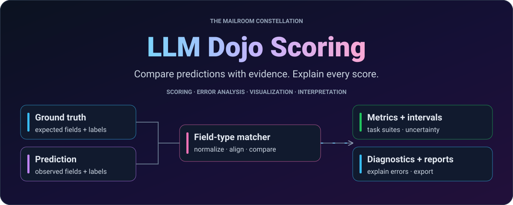
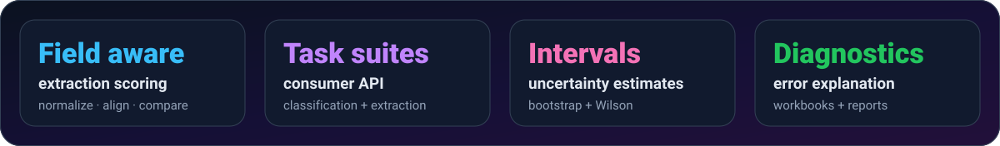

<div align="center">

<picture>
  <source media="(max-width: 640px)" srcset="docs/assets/readme/hero-mobile.svg"/>
  
</picture>

<br/>

[](pyproject.toml)
[](https://github.com/Exios66/llm-dojo-scoring/releases/tag/v0.24.2)
[](docs/SCORING.md)
[](pyproject.toml)

[](https://github.com/LLM-Mailroom-Services/Digital-Mailroom)
[](docs/SCORING.md)
[](docs/MIGRATION.md)

**[Quickstart](#quickstart)** · **[How it works](#how-it-works)** · **[Workflows](#workflows)** · **[API](#library-usage)** · **[Where it fits](#where-it-fits)** · **[Docs](#documentation)**

</div>

---

<!-- readme-v2.1 -->
<details>
<summary><b>📑 Contents</b></summary>

- [🥋 What is this?](#what-this-does)
- [🤔 When to reach for it](#when-to-reach-for-it)
- [📦 Install](#install)
- [🚀 Quickstart](#quickstart)
- [🧭 How it works](#how-it-works)
- [📟 At a glance](#at-a-glance)
- [🌌 Where it fits](#where-it-fits)
- [🔧 Workflows](#workflows)
- [🗺️ Module map](#module-map)
- [🎯 Task coverage](#task-coverage)
- [🧰 Library usage](#library-usage)
- [⚙️ Configuration](#configuration)
- [✅ Testing](#testing)
- [⌨️ CLI reference](#cli-reference)
- [📖 Documentation](#documentation)
- [🚢 Releases & monorepo sync](#releases--monorepo-sync)
- [❓ FAQ](#faq)
- [🙏 Built on](#built-on)
- [🤝 Contributing, security and license](#contributing-security-and-license)

</details>

<a id="what-this-does"></a>

## 🥋 What is this?

Language models are happy to tell you they did great. The Dojo checks. It is
**the shared, field-type-aware scoring engine for the Mailroom constellation**:
one importable library that compares document classifications and structured
extractions, quantifies the uncertainty, shows how each failure happened and
writes the report. A date is scored as a date, a dollar amount as an amount
and a party name as a name, instead of string-matching everything the same way.

The pipeline and the sandbox consume this source. Neither keeps a separate
implementation of its metrics, and the deterministic core needs no model, API
key or tracing service.

<div align="center">
<picture>
  <source media="(max-width: 640px)" srcset="docs/assets/readme/stats-mobile.svg"/>
  
</picture>
</div>

<a id="when-to-reach-for-it"></a>

## 🤔 When to reach for it

| ✅ Reach for it when… | ↪️ Look elsewhere when… |
| :--- | :--- |
| You score document classes or structured extractions against ground truth and want the same answer on every run | You want an LLM-as-a-judge rubric. The core never calls a model; the Judge agent and the Langfuse LLM-as-a-judge evaluators live in llm-mailroom |
| Your fields have types (dates, money, IDs, names, free text, entity lists) and plain string equality would mislead you | You need a general-purpose eval framework. The suites, profiles and bundles are built around the Mailroom document classes |
| You want confidence intervals and a failure-mode breakdown rather than one bare accuracy number | You want a live dashboard. The Dojo writes Markdown reports, plots and JSONL score manifests; it serves no UI |

<a id="install"></a>

## 📦 Install

<div align="center">

</div>

<div align="center">

```bash
pip install "llm-dojo-scoring @ git+https://github.com/Exios66/llm-dojo-scoring.git@v0.24.2"
pip install -e .                # from a local checkout
```

</div>

<details>
<summary>Optional extras</summary>

```bash
pip install -e ".[embeddings]"   # sentence-transformers + openai (embedding rescue)
pip install -e ".[tracing]"      # langfuse + phoenix + dotenv + OTLP
pip install -e ".[jellyfish]"    # no-op alias; jellyfish is already core
pip install -e ".[dev]"          # pytest
pip install -e ".[all]"          # embeddings + tracing + dev
```

</details>

A standalone consumer can pin this release explicitly:

```toml
[project]
dependencies = [
    "llm-dojo-scoring @ git+https://github.com/Exios66/llm-dojo-scoring.git@v0.24.2",
]
```

The pipeline currently pins **v0.23.1** in its own source. A new Dojo
release and a consuming application's pin are separate decisions; update
consumers through their release workflow rather than treating this example
as their current configuration.

<a id="quickstart"></a>

## 🚀 Quickstart

After installing, score three document-class predictions entirely offline:

```python
from llm_dojo_scoring import score_task

scores = score_task(
    "doc_class",
    expected=["contract", "correspondence", "insurance_claim"],
    predicted=["contract", "contract", "insurance_claim"],
)
print(scores)
```

Two of the three labels match. The returned dictionary includes task metrics
and confidence intervals; the one correspondence error remains visible in
the class-level results. No model, API key or tracing service is required.
For extraction, use the field-type-aware API in [Library Usage](#library-usage).


<a id="how-it-works"></a>

## 🧭 How it works

<div align="center">
<picture>
  <source media="(max-width: 640px)" srcset="docs/assets/readme/flow-mobile.svg"/>
  
</picture>
</div>

Ground truth and predictions enter a task suite. The engine normalizes and
aligns their fields or labels, computes metrics and uncertainty, then exposes
errors for analysis and export. Optional embedding rescue and tracing sinks
are separate integrations; the deterministic core does not require them.

| Layer | Responsibility | Entry point |
| :--- | :--- | :--- |
| Task suite | Agent-specific scoring contract | `get_suite(...)` |
| Comparison | Typed fields or task labels | `score_extraction(...)`, `score_task(...)` |
| Uncertainty | Confidence intervals and comparisons | `bootstrap_ci(...)` |
| Explanation | Failure modes, field diagnostics, reports | `dojo-analyze`, `dojo-export` |

<a id="at-a-glance"></a>

## 📟 At a glance

<div align="center">

</div>

<a id="where-it-fits"></a>

## 🌌 Where it fits

<div align="center">
<picture>
  <source media="(max-width: 640px)" srcset="docs/assets/readme/constellation-mobile.svg"/>
  
</picture>
</div>

| | Neighbour | Relationship |
| :---: | :--- | :--- |
| 🏛️ | [`Digital-Mailroom`](https://github.com/LLM-Mailroom-Services/Digital-Mailroom) | The integration hub. It imports this repository into `packages/llm-dojo-scoring`, and all scoring logic and metrics are authored here first |
| 🧠 | [`llm-mailroom`](https://github.com/Exios66/llm-mailroom) | The pipeline. It pins a Dojo release and scores its runs with the suites |
| 🧪 | [`local-mailroom-sandbox`](https://github.com/Exios66/local-mailroom-sandbox) | Scores sandbox runs with a vendored snapshot, refreshed from the hub |
| 🧠 | [`mailroom-ml`](https://github.com/LLM-Mailroom-Services/mailroom-ml) | Standalone contractor that consumes the Dojo taxonomy and never redefines it |

<a id="workflows"></a>

## 🔧 Workflows

### Analyze a workbook

```bash
dojo-analyze Sorter_Experiment_Results.xlsx --target 0.94 --min-n 100
# -> Sorter_Experiment_Results.xlsx.report.md  (+ *_plots/*.png)
```

### Regenerate workbooks from experiment log

```bash
dojo-export --task sorter --log reports/experiment_log.jsonl --outdir .
dojo-export --task all --sweep --log reports/experiment_log.jsonl
```

### Live sync from Langfuse / Phoenix

```bash
# Sync ALL subtype-classification runs
dojo-sync --task subtype_classification --outdir reports/live

# Sync one experiment (session) — fast, rate-limit friendly
dojo-sync --task subtype_classification \
          --session qwen3.7-flash_sorter_v13_subtype_langfuse --outdir reports/live

# Probe the local Phoenix/OTLP sink too
dojo-sync --check-phoenix
```

### Check the loaded Dojo version and available releases

```bash
dojo-version
dojo-version --check --force --json
dojo-version --check --offline --json
```

The opt-in `llm_dojo_scoring.update_awareness.UpdateChecker` shares a daily
per-user cache across application startup hooks and limits notices per consumer
and release. Pure imports and scoring stay offline. Set
`LLM_DOJO_UPDATE_CHECK=0` to disable all update checks and cache I/O. No packages
are upgraded automatically. See [update awareness](docs/UPDATE_AWARENESS.md)
for startup semantics, failure/exit codes, privacy and concurrency limits.
Available in v0.24.0; dependency pins remain operator controlled.

<a id="module-map"></a>

## 🗺️ Module map

<details>
<summary><b>The module map: what each module does</b></summary>

<div align="center">

| Module | What it does |
|:---|:---|
| `update_awareness` | Opt-in shared release discovery, startup cache and `dojo-version` |
| `field_scoring` | Field-type-aware deterministic extraction scoring (date/money/id/name/free_text/entity_list) |
| `classification` | Label normalization, exact match, per-class P/R/F1/F2, macro-PRF, confusion matrices |
| `extraction_metrics` | Field-micro extraction P/R/F1/F2 over (field, value) events |
| `claims_consistency` | Insurance `determination_consistency` and `amount_exactness` |
| `failure_modes` | Failure-mode taxonomy + `classify_failure`, per-subtype accuracy |
| `bootstrap` | Bootstrap CIs, two-sample delta significance, Wilson intervals |
| `cost` | Price lookup, cost estimation, usage aggregation |
| `diagnostics` | Run-level diagnostics: date/duration/money MAE+R², span drift, field error decomposition |
| `experiment` | JSONL record append/load, dotted-path access, git snapshot |
| `tasks` | Task-aware scoring across the full document hierarchy (MAUD, LegalBench, chained, etc.) |
| `suites` | Dedicated scoring suite per pipeline agent — the API consumers should call |
| `registry` | Metric definitions registry: every score name → tier (T0 HEADLINE → T3 LOG) |
| `bundles` | Eleven pre-built task bundles (classification, extraction, cost, factuality, etc.) |
| `profiles` | 27 agent profiles — each agent's scoring identity |
| `emitter` | Unified score emitter: JSONL manifest sink + inert Langfuse sink |
| `langfuse_sync` | Pull live experiment traces into run records + reference workbook |
| `phoenix_sync` | Local Phoenix/OTLP sink probe + span reader |

</div>

</details>

<a id="task-coverage"></a>

## 🎯 Task coverage

<details>
<summary><b>`score_task` keys and their headline metrics</b></summary>

`score_task(task, expected, predicted, ...)` is the single entry point for every classification task:

<div align="center">

| Task key | What it scores | Headline metrics |
|:---|:---|:---|
| `subtype` / `doc_class` / `multiclass` | CUAD 25-family subtype, primary doc-class, generic multi-class | exact match + CI, macro accuracy, per-class, confusion |
| `docclass` / `maud_docclass` | Hierarchical doc_type + second-level subclass | doc_type accuracy + macro P/R/F1/F2, subclass accuracy |
| `maud_question` / `maud_extraction` | MAUD consideration answers + 22 Hub questions | exact match + CI, per-class, macro |
| `enron_topic` / `enron_sentiment` | Enron correspondence topics & sentiment | accuracy, macro-F1, per-class |
| `legalbench` | LegalBench binary Yes/No | exact match + CI, per-class, binary P/R/F1 |
| `chained` | Composite sorter→extractor runs | sorter exact + extractor overall, weighted composite |
| `contracteval` | ContractEval clause-mapping benchmark | F2, Jaccard, no-related rate, per-category |
| `transcription` / `wer` | PDF→text / OCR hypothesis vs reference | WER, CER, word_accuracy |

</div>

</details>

<a id="library-usage"></a>

## 🧰 Library usage

```python
import llm_dojo_scoring as dojo

# 1. Score one extraction (field-type-aware, with factuality audit)
result = dojo.score_extraction(
    "contract", field_types, predicted, expected, doc_text=text,
)

# 2. Bootstrap a CI over per-document scores
ci = dojo.bootstrap_ci([1.0, 0.0, 1.0, 1.0])

# 3. Aggregate tokens/cost
summary = dojo.tokens_summary(usage_records, model="qwen/qwen3.7-flash")

# 4. Dedicated suite: the import mailroom projects should use
suite = dojo.get_suite("insurance_claims_specialist")
result = suite.score(expected_fields, predicted_fields)

# 5. Emit through sinks; query scorecards
emitter = dojo.Emitter(sinks=[
    dojo.LocalManifestSink("reports/scores_manifest.jsonl"),
    dojo.LangfuseSink(),
])
emitter.emit_score(
    "sorter", "doc_17", "accuracy", 0.93, run_id="exp_42",
    # Required (#22); USD metrics also need cost_basis.
    provenance={"dataset_revision": "46a4d3c2", "prompt_id": "sorter_v3",
                "serving_kind": "api", "model_id": "qwen/qwen3.7-flash"},
)
```

<a id="configuration"></a>

## ⚙️ Configuration

All thresholds, equivalence sets, subtype lists, cost tables, and failure-mode definitions live in one `Settings` object:

```python
from llm_dojo_scoring import configure, load_settings

configure(field_scoring__bipartite_match_threshold=0.7)
settings = load_settings("config/taxonomy.yaml")
```

Set `LLM_DOJO_SCORING_CONFIG` to a YAML path for the process-wide override.

<a id="testing"></a>

## ✅ Testing

<a id="tests"></a>

```bash
pip install -e ".[dev]"
python -m pytest
```

Docstrings are required for every Python module, class, and function, including
private helpers, nested definitions, scripts, examples, and tests. Run the
repository-wide coverage gate with
`python -m pytest tests/test_docstring_coverage.py`.

<a id="cli-reference"></a>

## ⌨️ CLI reference

<div align="center">

```
dojo-version [--check [--force|--offline]] [--json]
dojo-analyze INPUT [-o REPORT.md] [--plots DIR] [--metric COL] [--target 0.94]
                  [--min-n N] [--cost-column COL] [--task T] [--max-items N]
dojo-export  [--task sorter|extraction|all] [--sweep] [--log LOG] [--outdir DIR]
dojo-sync    [--task TRACE_NAME] [--session NAME] [--max-items N]
             [--env-file FILE] [--outdir DIR] [--no-workbook] [--check-phoenix]
```

</div>

<a id="documentation"></a>
<a id="migration"></a>

## 📖 Documentation

See [`docs/MIGRATION.md`](docs/MIGRATION.md) for the exact import swap. Scoring tables: [`docs/SCORING.md`](docs/SCORING.md). Prompt catalog and eval-environment prompt lineage (`list_prompt_versions`, `prompt_chain`, `diff_prompt_versions`): [`docs/PROMPTS.md`](docs/PROMPTS.md).

<a id="releases--monorepo-sync"></a>

## 🚢 Releases & monorepo sync

This package is the shared scoring engine consumed by llm-mailroom
and the sandbox (vendored) — version bumps are cross-package
events.

- **Source ownership**: this independent repository owns scoring implementation.
  Review and merge changes here first. The
  [Digital-Mailroom](https://github.com/LLM-Mailroom-Services/Digital-Mailroom)
  monorepo then imports the exact merged revision into
  `packages/llm-dojo-scoring` and refreshes its sandbox vendor snapshot.
  Do not export downstream implementation patches over completed source work.
- **Release-time pin law**: cutting a release means bumping the version here
  AND updating every consuming pin — llm-mailroom /
  sandbox `pyproject.toml` git pins and the sandbox vendor snapshot.
  The dojo pin is bumped ONLY at release time of this package, via
  `src/scripts/bump_dojo_scoring.py` in the llm-mailroom source — never delete a
  pin line. After the release, import the merged source revision and refresh
  the sandbox vendor tree (`scripts/sync_vendor.py`). Verify the changed
  package and every dependant; source and vendor imports must identify the
  same release code, even when unrelated distribution metadata is installed.

<a id="faq"></a>

## ❓ FAQ

<details>
<summary><b>Does scoring need an API key or a network connection?</b></summary>

No. The deterministic core needs no model, API key or tracing service. Embedding rescue (`[embeddings]`) and the Langfuse/Phoenix sinks (`[tracing]`) are opt-in extras, and release checks only run through the opt-in `UpdateChecker`; `LLM_DOJO_UPDATE_CHECK=0` turns them off entirely.

</details>

<details>
<summary><b>Why not just compare the strings?</b></summary>

Because `"March 3, 2026"` and `"2026-03-03"` are the same fact. `field_scoring` uses one algorithm per field type: IDs are normalized then matched exactly, dates are parsed to ISO with partial-credit fallbacks, money is parsed and compared with a one-cent tolerance, names use Jaro-Winkler plus a token-set ratio, free text uses SQuAD-style token F1, and entity lists use Hungarian bipartite matching.

</details>

<details>
<summary><b>Which function should my project call?</b></summary>

Consumers should call the dedicated suite for each pipeline agent, `get_suite("<agent>")`. `score_task(...)` is the single entry point for classification tasks and `score_extraction(...)` scores one extraction. See [Library usage](#library-usage) and [Task coverage](#task-coverage).

</details>

<details>
<summary><b>What do the tiers T0 to T3 mean?</b></summary>

They are the dashboard discipline in `registry`: **T0 HEADLINE** is one board-level number per agent, **T1 CORE** answers "what broke yesterday?", **T2 DEEP** is root-cause investigation (confusion matrices, failure modes) and **T3 LOG** is audit trail and regression comparison only.

</details>

<details>
<summary><b>How does a new Dojo release reach the pipeline?</b></summary>

Only at release time. The pin is bumped in the llm-mailroom source with `src/scripts/bump_dojo_scoring.py`, and the hub then imports both sources and refreshes the sandbox vendor snapshot. Pin lines are never deleted; see [Releases & monorepo sync](#releases--monorepo-sync).

</details>

<a id="built-on"></a>

## 🙏 Built on

The deterministic core stands on a small, boring stack:

| Project | What it does here |
| :--- | :--- |
| [pandas](https://pandas.pydata.org/) · [SciPy](https://scipy.org/) | Score tables, and the Hungarian matcher (`linear_sum_assignment`) for entity lists. Bootstrap CIs use only the standard library |
| [jellyfish](https://github.com/jamesturk/jellyfish) | Jaro-Winkler similarity for name fields |
| [python-dateutil](https://github.com/dateutil/dateutil) | Date parsing before comparison |
| [Matplotlib](https://matplotlib.org/) · [openpyxl](https://openpyxl.readthedocs.io/) | `dojo-analyze` plots and the Excel workbooks |
| [Langfuse](https://langfuse.com/) · [Arize Phoenix](https://phoenix.arize.com/) (optional) | `dojo-sync` and the tracing sinks, behind the `[tracing]` extra |

<a id="contributing-security-and-license"></a>

## 🤝 Contributing, security and license

| | |
| :--- | :--- |
| **Contributing** | Scoring logic and metrics are authored here first, with tests and docstrings (the [docstring coverage gate](#testing) is part of the suite). The hub [contributing guide](https://github.com/LLM-Mailroom-Services/Digital-Mailroom/blob/main/CONTRIBUTING.md) covers the card workflow and the import into Digital-Mailroom. |
| **Security** | Report vulnerabilities privately as described in the hub [security policy](https://github.com/LLM-Mailroom-Services/Digital-Mailroom/blob/main/SECURITY.md), which covers this package; never post exploit details in a public issue. |
| **License** | MIT, declared in [`pyproject.toml`](pyproject.toml). There is no standalone `LICENSE` file yet. |

---

<div align="center">

**[Digital-Mailroom](https://github.com/LLM-Mailroom-Services/Digital-Mailroom)** ·
**[llm-mailroom](https://github.com/Exios66/llm-mailroom)** ·
**[llm-dojo-scoring](https://github.com/Exios66/llm-dojo-scoring)** ·
**[The-Mailroom](https://github.com/Exios66/The-Mailroom)** ·
**[local-mailroom-sandbox](https://github.com/Exios66/local-mailroom-sandbox)** ·
**[Mailroom-Corpus-EDA](https://github.com/Exios66/Mailroom-Corpus-EDA)** ·
**[mailroom-ml](https://github.com/LLM-Mailroom-Services/mailroom-ml)**

<sub>LLM Dojo Scoring · one of the Mailroom constellation's independent source repositories, with shared interfaces.</sub>
<br/>
<sub>Core packages integrate in Digital-Mailroom; mailroom-ml is a standalone contractor.</sub>
<br/>
<sub>🥋 <i>Score the extraction, not the vibes.</i> · Artwork: <a href="docs/assets/readme/README.md">design and regeneration</a></sub>

</div>
